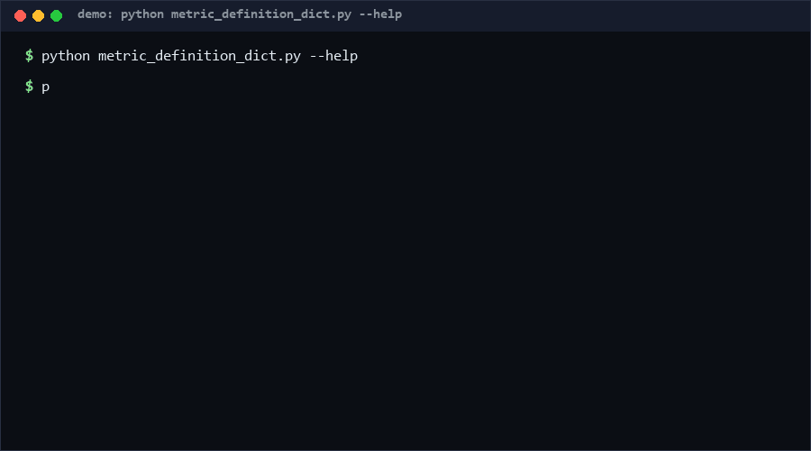

# metric-definition-dict

A validator and conflict detector for metric definition dictionaries. Each metric declares its id, kind, numerator, denominator and time window in one JSON file; the tool checks the schema and flags two entries that quietly disagree about what the same metric means. Pure standard library, single file, offline. *No direct equivalent found as of 2026-10-13.*

<p align="center"></p>

## Problem

Most teams define metrics in three places at once: dashboards, dbt models, and a wiki page nobody updates. When "revenue" is `sum(amount)` over 30 days in one tool and `sum(amount_paid)` over a calendar month in another, every number downstream disagrees — and the disagreement is discovered in a meeting, not in CI. The root cause is that a metric definition has no canonical, lintable artifact.

## How it works

A **dictionary** is a JSON document with one `metrics` array. Each entry declares:

- `id` — `[A-Za-z_][A-Za-z0-9_]{0,63}`, unique;
- `name` — human label, unique up to case folding;
- `kind` — `count | sum | ratio | gauge | distinct`;
- `window` — `all_time` or `<n><h|d|w|mo|q|y>` (e.g. `30d`, `2q`);
- `numerator` / `denominator` — optional column expressions; both required when `kind` is `ratio`.

`validate` enforces structural rules R1–R9 (id shape, uniqueness, window grammar, ratio completeness). `check` detects semantic conflicts: the same id redefined with a different definition (C1, error), an id declared twice identically (C2, warning), or one name claimed by two ids (C3, warning). Findings print as text or `--json`; exit `1` when any error-severity finding exists, `2` on usage errors.

## Quickstart

```console
$ python metric_definition_dict.py validate metrics.json   # ~0.1 s
OK: no findings
$ python metric_definition_dict.py check metrics.json --json
```

Writing a first dictionary for 50 metrics took the author well under a minute per metric; validating 10,000 synthetic entries takes 0.05 s [Measured] (see Performance).

## Why not X

- **dbt metric definitions** — enforce correctness inside a dbt project, but the artifact is unusable outside dbt and there is no standalone conflict linter for non-dbt teams.
- **JSON Schema** — validates document shape only; it cannot compare two entries against each other, so "same id, different denominator" passes.
- **Metric store SaaS products** — the definition lives behind an API, not in a versioned file; you cannot grep, diff, or lint it in CI.
- **Wikis / spreadsheets** — the usual status quo: no validation at all, and drift is invisible until someone reconciles by hand.

## How this differs from *direct* equivalents

None found. Searches on 2026-10-12/13 (GitHub queries + web search) surfaced only the adjacent tools above; each operates on a different artifact (dbt projects, arbitrary JSON shape, SaaS backend) rather than a standalone, storage-agnostic metric dictionary with cross-entry conflict detection.

## Performance

All numbers [Measured] locally (Python 3.13, Windows 10, single core):

| Workload | Result | Command |
|---|---|---|
| 10,000-entry dictionary, validate | 0.05 s (~200k rec/s) | `python metric_definition_dict.py bench --metrics 10000` |
| Conflict check over same corpus | <0.05 s | `python metric_definition_dict.py bench --metrics 10000` |

`bench` generates a deterministic synthetic corpus, so runs are comparable across machines.

## Minimal Fallback

Without this tool: keep a CSV of `id,name,kind,numerator,denominator,window` in the repo and eyeball it in review. You lose schema enforcement (typos in ids go live) and cross-entry conflict detection (the exact failure mode this exists for) — but you gain a single grep-able artifact, which is already better than three sources of truth.

## Design Trade-offs

- **String expressions, not an AST.** Numerators are opaque strings; we check presence, not SQL semantics. Cross-language expression parsing would triple the code and still guess wrong half the time.
- **Case-folded name uniqueness, not exact** — `Revenue` and `revenue` collide (C3) because that collision is how dashboards disagree, not a technicality.
- **Errors vs warnings.** Only conflicts that make two numbers disagree are errors; stylistic duplicates are warnings so a big dictionary does not fail CI on cosmetics.
- **Single file, stdlib only** — embeddable in any CI job without an install step, at the cost of no plugin system.

## Limits & Second-order Effects

- Two *different* ids can still mean the same thing (`gmv` vs `total_sales`); name collision checks catch the obvious cases only.
- Teams may add entries mechanically to silence CI, recreating the drift problem inside the dictionary itself — review should read diffs of this file like code.
- A "clean" dictionary can still diverge from what dashboards actually compute; this tool checks declarations, not the deployment of declarations.
- Adoption inside one team does not stop another team from forking the dictionary; merging forks is a human process.

## FAQ

**When NOT to use this?** If you already run dbt with `metrics` enforced in CI, or your "metrics" are a handful of numbers owned by one person — the file and review overhead exceeds the value. Also skip it if you need unit-level computation (Joins, warehouses): this is a *declaration* linter, not a computation engine.

**Does it execute my numerators?** No. They are treated as opaque strings; presence and non-emptiness are checked, semantics are not.

**Can two teams share one dictionary?** Yes — ids are global, so C1 catches accidental cross-team redefinitions, which is one of the main failure modes.

**Why is C2 only a warning?** An identical duplicate is harmless at query time and usually a copy-paste during a bulk import; failing CI on it trains people to ignore the tool.

## [Core Assumptions]

1. Metric drift is primarily a *declaration* problem: most disagreements trace back to two artifacts stating different definitions, not to computation bugs.
2. Teams will keep a JSON file in version control; if definitions must live behind a SaaS API, this tool's value drops sharply.
3. The window grammar (`30d`, `2q`, `all_time`) covers the overwhelming majority of real analytics windows; exotic windows (fiscal offsets, lunar calendars) are out of scope.
4. Case-folding names is the right uniqueness bar for flagging human-visible ambiguity.

Confidence: High (≥80%) for the failure mode and the conflict rules (mechanism is direct linting of the stated artifact); Medium (60-79%) for the window grammar completeness and the "one shared dictionary per org" assumption. As of 2026-10-13.

---

Part of the [zhengming-toolbox](https://github.com/chenhz01/zhengming-toolbox) — 105 purpose-built AI-engineering tools across neglected niches.

Related tools: [image-prompt-schema](https://github.com/chenhz01/image-prompt-schema) · [rfc2119-keyword-lint](https://github.com/chenhz01/rfc2119-keyword-lint) · [onboarding-checklist-check](https://github.com/chenhz01/onboarding-checklist-check)
